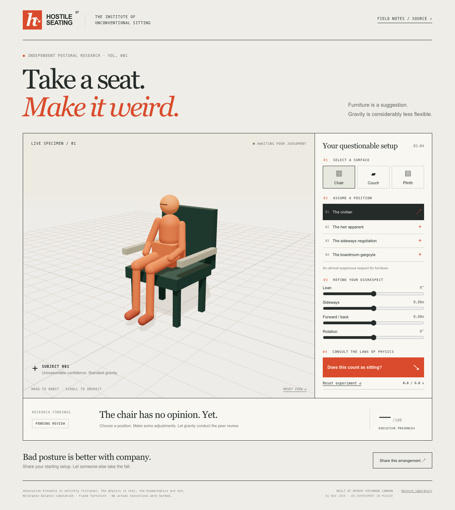

# Hostile Seating

**Take a seat. Make it weird.** A small 3D physics playground for sitting on things incorrectly, inspired by Roman Roy's relationship with furniture.

- **Play:** https://sit.thunkoid.com
- **Watch the demo (50 seconds, captioned):** https://sit.thunkoid.com/demo.mp4
- **Source:** https://github.com/SeanRivardMorton/hostile-seating
- **Build contract:** [PRD.md](PRD.md)
- **Agent instructions:** [AGENTS.md](AGENTS.md)
- **Codex contribution:** [CODEX.md](CODEX.md)



## The complete journey
Choose a chair, couch or plinth → pick a questionable pose → adjust lean, placement and rotation → release gravity → read the verdict → reset or share a link to the starting arrangement.

## Run locally
Requires Node.js 22+ and pnpm 10.

```sh
pnpm install --frozen-lockfile
pnpm dev
```

Open the address printed by Vite. No API keys, accounts, database or external runtime assets are required.

```sh
pnpm typecheck
pnpm build
pnpm exec playwright install chromium
pnpm test
pnpm preview
```

Tests cover a normal supported sit, an unsupported fall, repeated reset/run cycles, share-link reconstruction, malformed parameters and mobile layout. To test a deployed site, set `DEMO_URL=https://sit.thunkoid.com` when running `pnpm test`.

## What is being simulated?
Rapier applies gravity and collision response to an original procedural mannequin and furniture. The prototype uses a **held-pose compound rigid body**, not a muscle-driven articulated human. Limbs stay posed relative to one another during each trial. Furniture is fixed. The result is a toy balance experiment rather than an ergonomic or medical model.

Trials run at a fixed timestep for up to six simulated seconds. Results are based on observed body state and furniture contact. The Executive Presence score is a fictional joke, not a scientific measurement. Shared links restore the starting configuration, not an exact cross-device trajectory. This is deliberately a small prototype, not an exhaustive catalogue of human sitting.

## Cloudflare deployment
The Vite output, including Rapier physics code, is bundled and served by a dedicated Cloudflare Worker. `wrangler.jsonc` attaches the custom domain `sit.thunkoid.com`; Cloudflare handles DNS and HTTPS.

```sh
pnpm exec wrangler login
pnpm deploy
```

Deployment requires access to the Cloudflare account holding the `thunkoid.com` zone. Credentials remain outside the repository. Build/runtime secrets are not required by the app.

## Persistent remote development
Development can run in a persistent `tmux` session on a Linux server. Losing SSH connectivity does not stop the remote process. Use your configured SSH host, then:

```sh
tmux list-sessions
tmux attach -t hostile-seating
```

Detach without stopping the session with `Ctrl-b`, then `d`. When a bounded agent task completes, the session may close; its durable output log and result file remain in the server user's home directory. Inspect those before restarting. Never launch duplicate agents editing the same files.

The delivered `hostile-seating` session has an `agent` window for interactive Codex and a `preview` window serving the production build on loopback port 4173. To recreate the agent window from the project root, run `bash scripts/server-session.sh` inside tmux. That script starts in readiness-only mode and waits for your next request. Server-side code changes can be tested, committed and pushed with the repository-specific deploy key. Cloudflare authentication has also been provisioned outside git in a dedicated user configuration directory and verified with a deployment from the server. The session script selects that directory automatically, so the agent can run `pnpm deploy` when asked.

The initial Codex task is preserved in [REMOTE-TASK.md](REMOTE-TASK.md). Agents should work from the PRD, log checks in [PROGRESS.md](PROGRESS.md), and checkpoint verified work in Git. API credentials used by development agents are not shipped to the browser or stored in this repository. The installed server session uses a repository-specific GitHub write deploy key and a noreply Git identity, not your general GitHub login.

The server blocks the user namespaces needed by Codex's Linux sandbox. Its bounded scene task therefore ran as the existing non-root server user without that OS sandbox. No host security settings were changed. The terminal session is intended for this trusted project; the app itself executes in visitors' browsers on Cloudflare.

## Credits and provenance
Created during the DevDay Exchange Community Hackathon in London on 1 November 2026. Source began as a new project during the event, with handwritten configuration rather than a pre-existing application template. The scene, furniture, mannequin, UI and writing are original procedural/code-based work created with AI coding assistance. No Succession clips, actor likenesses, licensed furniture models, stock images or external fonts are used. Succession is inspiration only; this project is unaffiliated.

Open-source foundations: [React](https://react.dev), [Three.js](https://threejs.org), [React Three Fiber](https://r3f.docs.pmnd.rs), [Drei](https://github.com/pmndrs/drei), [Rapier](https://rapier.rs), [React Three Rapier](https://github.com/pmndrs/react-three-rapier), [Vite](https://vite.dev), [TypeScript](https://www.typescriptlang.org), [Playwright](https://playwright.dev), and [Cloudflare Workers/Wrangler](https://developers.cloudflare.com/workers/). Their respective licences apply to their packages.

Current docs consulted: [Codex quickstart](https://developers.openai.com/codex/quickstart), [Codex non-interactive mode](https://developers.openai.com/codex/non-interactive-mode), [Fiber introduction](https://r3f.docs.pmnd.rs/getting-started/introduction), [Rapier wrapper](https://pmndrs.github.io/react-three-rapier/), [Cloudflare static assets](https://developers.cloudflare.com/workers/static-assets/), and [custom domains](https://developers.cloudflare.com/workers/configuration/routing/custom-domains/).

## Demo
The [50-second captioned recording](https://sit.thunkoid.com/demo.mp4) shows real interactions with the public app: supported sitting, a fall, furniture/pose changes and opening a shared link. It contains no terminal or authentication footage. See [DEMO.md](DEMO.md) for the narrated ≤90-second sequence.

To reproduce the recording (requires FFmpeg for MP4 encoding):

```sh
node scripts/record-demo.mjs
ffmpeg -i test-results/demo/raw.webm -c:v libx264 -crf 27 -preset fast -pix_fmt yuv420p -movflags +faststart -an public/demo.mp4
```
